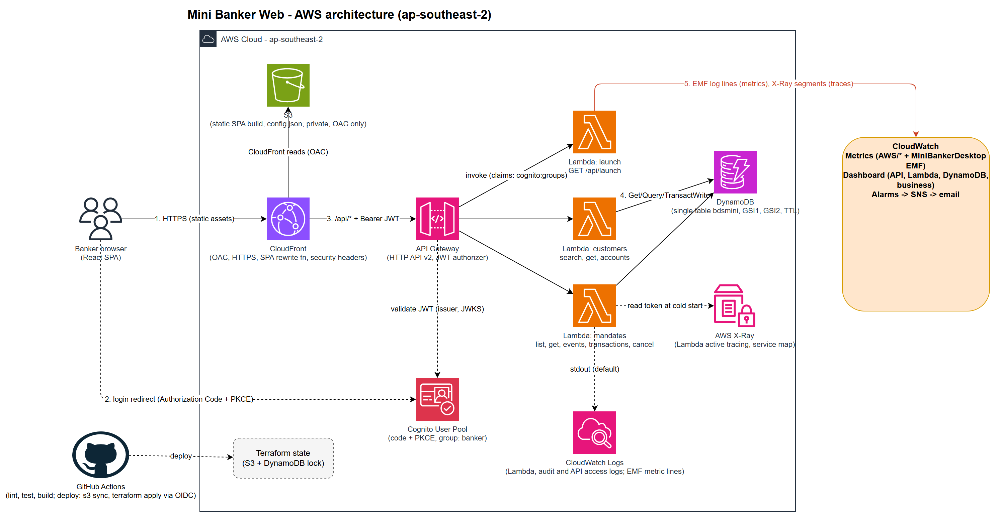
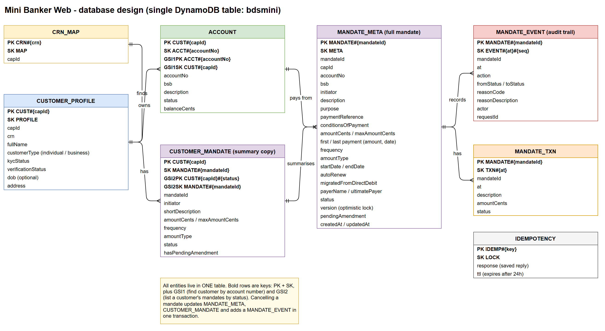

## Mini Banker Web
A simplified web app that is used by bankers to query transactions of user accounts and process applications mandate from users.

## Functional Requirements

- A banker must sign in before using the app.
- Only users with the banker role can search for customers or cancel mandates.
- A banker can search a customer by customer reference number (CRN).
- After finding a customer, the banker can see all of that customer's accounts.
- The banker can see the customer's PayTo mandates (the agreements that let a business or person collect payments from the customer's account).
- The banker can cancel a mandate that is still active or paused.
- The app asks the banker to pick a reason for the cancellation before it goes ahead.
- A mandate that is already cancelled cannot be cancelled again. The app explains why instead of doing nothing.
- If the banker accidentally submits the same cancellation twice (for example, by double-clicking), it only takes effect once.
- After a cancellation, the mandate shows as cancelled straight away.
- Every cancellation is recorded: who did it, when, which mandate, and why. This record cannot be changed afterwards.

## Architecture



## Tech Stack

| Technology | What it does here |
|------------|-------------------|
| TypeScript (Node 22) | One language for the whole project, with strict type checking to catch mistakes early. |
| React | The screens bankers use, built as a single-page app. |
| oidc-client-ts | Sends the banker to the login page and brings them back signed in. |
| AWS Lambda | Small functions that run the business logic only when a request arrives. |
| API Gateway (HTTP API) | Receives requests from the browser, checks the login token and passes them to the right function. |
| DynamoDB | Stores customers, accounts, mandates and the cancellation record. |
| Amazon Cognito | Holds the banker accounts and the banker group, and issues login tokens. |
| S3 and CloudFront | S3 stores the built website privately, and CloudFront serves it securely to users. |
| CloudWatch and X-Ray | Collect logs, charts, alarms and request traces so we can see how the app is behaving. |
| Terraform | Describes all the cloud resources as code, so the environment can be created or removed repeatedly. |
| GitHub Actions | Runs checks and tests on every change, then deploys to AWS. |
| Playwright | Drives a real browser through the full app to check the main flows work. |
| Docker and esbuild | Docker runs the local database, and esbuild bundles each Lambda function. |

## Database Design



## Project Structure

```
mini-banker-web/
├── shared/                  # Code every other part uses: data shapes, database keys, rules
│   └── src/                 # keys.ts (database keys), mandateStateMachine.ts (allowed status changes), api.ts (request/response shapes)
├── backend/                 # The server side that answers the website's requests
│   ├── src/
│   │   ├── lambda/          # Entry points, one per cloud function (launch, customers, mandates)
│   │   ├── http/            # Turns web requests into code calls: login check, routing, input checking, errors
│   │   ├── handlers/        # What each web address does (launch, customers, mandates)
│   │   ├── domain/          # Core banking rules, such as cancelling a mandate, with no database code
│   │   ├── repo/            # Reads and writes the database
│   │   ├── telemetry/       # Sends usage numbers and logs to CloudWatch
│   │   ├── local/           # Small server for running on your own computer, with a fake login
│   │   ├── config.ts        # Reads settings from the environment
│   │   └── deps.ts          # Connects the pieces together
│   └── scripts/             # Build script that bundles each function
├── frontend/                # The website the banker sees
│   ├── src/
│   │   ├── screens/         # Full pages: search, customer, mandate details, cancel pop-up
│   │   ├── components/      # Small reusable pieces such as tabs and messages
│   │   ├── api/             # Code that talks to the backend
│   │   ├── auth.ts          # Sign-in handling
│   │   └── format.ts        # Formats dates and money for display
│   └── public/              # Static files, including config.json
├── seed/                    # Loads fake customers, accounts and mandates into the database
│   └── src/                 # fixtures.ts (the fake data), seedTable.ts (the loader)
├── e2e/                     # Browser tests that click through the whole app
│   └── tests/               # The test scenarios
├── infra/                   # Terraform files that build the cloud setup
│   ├── bootstrap/           # One-off setup that must exist first
│   ├── envs/dev/            # The dev environment, assembled from the modules
│   ├── modules/             # Building blocks: api, cognito, dynamodb, github_oidc, lambda, observability, static_site
│   └── teardown.sh          # Script to remove the cloud setup
├── docs/                    # Design notes, deployment plan, diagrams
├── .github/workflows/       # Automatic checks (ci.yml) and deployment (deploy.yml)
└── docker-compose.yml       # Starts the local database
```
